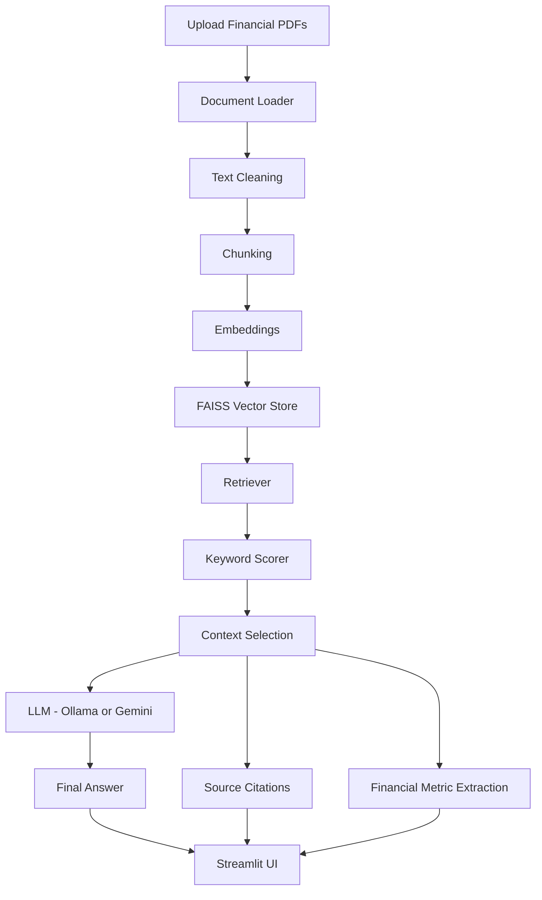

# FinSight RAG

FinSight RAG is an LLM-powered financial research assistant for analyzing financial documents such as 10-K filings and annual reports.

It uses Retrieval-Augmented Generation (RAG) to answer finance-specific questions with **source-backed evidence, page references, and extracted financial insights**.

---

## Features

- Upload and analyze PDF/TXT financial documents
- Build temporary or persistent FAISS knowledge base
- Multi-document question answering
- Company-level comparison (Apple, Microsoft, NVIDIA)
- Source-backed answers with page citations
- Financial metric extraction (money values, %, years, quarters)
- Keyword-based relevance scoring for improved retrieval precision
- Semantically-driven document summarization
- LLM-as-judge answer quality evaluation
- Session-based chat history for reviewing previous questions and answers
- Local LLM inference using Ollama or Google Gemini API

---

## System Architecture



---

## Architecture Diagram


---

## Tech Stack

- Python
- Streamlit
- FAISS
- Sentence Transformers (all-MiniLM-L6-v2)
- Ollama (Llama 3.1 8B) or Google Gemini API
- PyPDF
- NumPy
- Transformers

---

## Project Structure

```text
FinSight_RAG/
├── README.md
├── app.py
├── requirements.txt
├── .env.example                    ← safe environment template
├── .gitignore
├── test_retriever.py
├── test_loader.py
├── test_pipeline.py
│
├── data/
│   └── uploaded_docs/
│
├── evaluation/
│   ├── evaluate_rag.py
│   └── evaluation_results.txt
│
├── screenshots/
│   ├── 01_home_loaded_database.png
│   ├── 02_risk_factors_answer.png
│   ├── 03_revenue_drivers_answer.png
│   ├── 04_cloud_ai_strategy_answer.png
│   ├── 05_chat_history.png
│   └── 06_architecture_diagram.png
│
├── src/
│   ├── document_loader.py
│   ├── text_cleaner.py
│   ├── chunker.py
│   ├── embeddings.py
│   ├── vector_store.py
│   ├── retriever.py
│   ├── keyword_scorer.py   ← lexical relevance scoring
│   ├── metric_extractor.py
│   ├── llm_generator.py
│   └── rag_pipeline.py
│
└── vector_store/           |
      ├── index.faiss       |← not committed(see .gitignore)
      └── metadata.pkl      |

```

---

## Screenshots

### 1. Loaded Knowledge Base


---

### 2. Risk Factor Comparison


---

### 3. Revenue Driver Comparison


---

### 4. Cloud, AI, and Data Center Strategy


---

### 5. Chat History


---

## Setup Instructions

### 1. Clone repository

```bash
git clone <your-repo-url>
cd FinSight_RAG
```

### 2. Create virtual environment

```bash
python -m venv venv
venv\Scripts\activate        # Windows
source venv/bin/activate     # Mac/Linux
```

### 3. Install dependencies

```bash
pip install -r requirements.txt
```

### 4. Configure LLM

Create a `.env` file in the project root. Two options:

**Option A — Local Ollama (free, runs on your machine):**
```
LLM_PROVIDER=ollama
OLLAMA_MODEL=llama3.1:8b
```
Then install Ollama and run: `ollama pull llama3.1:8b`

**Option B — Google Gemini API:**
```
LLM_PROVIDER=gemini
GEMINI_API_KEY=your_key_here
GEMINI_MODEL=gemini-2.0-flash
```

### 5. Run app

```bash
streamlit run app.py
```

---

## Example Questions

- Compare the main revenue drivers for Apple, Microsoft, and NVIDIA
- Compare the main risk factors across Apple, Microsoft, and NVIDIA
- Compare the cloud, AI, and data center strategy across Microsoft and NVIDIA
- What financial metrics are mentioned across the filings?

---

## Evaluation

The project includes an evaluation script that measures both **retrieval quality** and **answer quality**.

**Metrics:**
- **Source coverage** — did the retriever pull from the expected documents?
- **Latency** — how long did each query take?
- **Retrieved chunks** — how many evidence chunks were used?
- **Answer quality (1–5)** — LLM-as-judge score based on defined criteria for each question

**Run:**

```bash
python evaluation/evaluate_rag.py
```

**Sample output:**

```
Average source coverage : 1.0
Average latency         : ~9 seconds
Average quality score   : 4.0 / 5
```

The quality scorer uses your configured LLM (Gemini or Ollama) to evaluate each answer against criteria such as whether it names specific revenue segments, cites sources, and distinguishes between companies.

---

## Retrieval Design Notes

**Embedding model:** `all-MiniLM-L6-v2` (sentence-transformers) — a general-purpose semantic embedding model used to convert text chunks and queries into vectors for FAISS similarity search.

**Keyword scoring:** After FAISS retrieval, chunks are re-scored by lexical overlap between the query terms and the chunk text. This improves precision for finance-specific queries where exact terminology (e.g., "risk factors", "Q4 revenue") matters alongside semantic similarity.

**Company-aware retrieval:** For multi-company comparison questions, the pipeline detects which companies and topics are mentioned and runs separate targeted queries per company, then merges and deduplicates results. This ensures balanced evidence across documents.

**Known limitations:**
- Company detection is currently scoped to Apple, Microsoft, and NVIDIA (the loaded 10-Ks). Extending to new companies requires uploading their documents.
- The embedding model is general-purpose, not fine-tuned on financial text.
- LLM-as-judge scoring reflects the same model's judgment — it is a useful signal, not a ground-truth metric.

---

## Future Improvements

- Table extraction from financial statements (income statements, balance sheets)
- SEC EDGAR API integration for automatic document fetching
- Multi-year trend analysis across annual filings
- PDF highlighting to show retrieved source passages
- Cloud deployment (Streamlit Cloud or Docker)
- Finance-specific embedding model (e.g., FinBERT-based)
